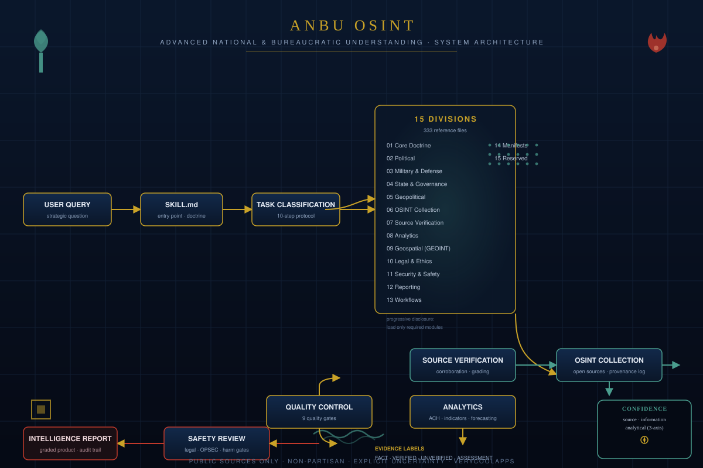

# ANBU OSINT

[](anbu/manifests/files_manifest.json)
[](#architecture)
[](#architecture)
[](#safety--ethics)
[](https://www.vcadeveloper.com)

> **Advanced National & Bureaucratic Understanding**
>
> **BEYOND INFORMATION. UNDERSTAND THE STRUCTURE OF POWER.**

ANBU OSINT is a modular, enterprise-grade intelligence analysis skill for AI agents. It transforms publicly available information into graded, verified, ethically bounded analytical products — structured the way professional all-source intelligence tradecraft works, constrained to open sources only.

---

## What ANBU Is

ANBU is an **OSINT strategic intelligence system**: a discipline of collecting, evaluating, correlating, and reporting publicly available information to answer strategic questions about political, military, state, geopolitical, legal, and security developments.

It is **not** a government agency, holds **no** classified material, and produces **analysis** — never operational targeting, doxxing, or instructions that enable harm.

Every product distinguishes observation from inference, marks uncertainty explicitly, and refuses to fabricate capability.

## Design Philosophy — The Feng Shui of the Machine

ANBU's information architecture follows feng shui principles translated into information design:

| Feng Shui Principle | System Translation |
|---|---|
| Dark, anchored space | Deep navy / obsidian interface; density without noise |
| Muted gold accents | High-value findings highlighted, not shouted |
| Subtle jade | Verified/corroborated items carry quiet confirmation |
| Minimalist red | Reserved for low-confidence, contested, or ethically flagged material |
| Calm precision | Ordered divisions, deterministic workflows |
| Flow without obstruction | Progressive disclosure — load only what a task requires |

## Architecture — 15 Divisions, 333 Files

| # | Division | Path | Domain |
|---|---|---|---|
| 001 | Core | `anbu/SKILL.md` + `anbu/core/` | Identity, doctrine, protocols, confidence, QA |
| 002 | Political | `anbu/political/` | Elections, parties, elites, public opinion (25 files) |
| 003 | Military | `anbu/military/` | Force posture, procurement, doctrine, exercises (35 files) |
| 004 | State | `anbu/state/` | Governance, bureaucracy, institutions, budgets (30 files) |
| 005 | Geopolitical | `anbu/geopolitical/` | Alliances, conflicts, sanctions, power balances (35 files) |
| 006 | OSINT | `anbu/osint/` | Collection tradecraft, source classes, open data (35 files) |
| 007 | Verification | `anbu/verification/` | Authenticity, provenance, corroboration (25 files) |
| 008 | Analytics | `anbu/analytics/` | Structured techniques, ACH, forecasting (30 files) |
| 009 | Geoint | `anbu/geoint/` | Geospatial analysis, imagery, terrain (20 files) |
| 010 | Legal | `anbu/legal/` | Law, treaties, privacy, accountability (20 files) |
| 011 | Security | `anbu/security/` | OPSEC, data protection, harm prevention (20 files) |
| 012 | Reporting | `anbu/reporting/` | Formats, templates, dissemination standards (20 files) |
| 013 | Workflows | `anbu/workflows/` | Pipelines, orchestration, repeatable procedures (18 files) |
| 014 | Manifests | `anbu/manifests/` | Inventories, dependency graphs, safety boundaries |
| 015 | Reserved | — | Future expansion |



## Capabilities

- **Structured collection** — OSINT tradecraft across 35 modules: search operators, open government data, registries, archives, media, social media, geospatial sources.
- **Evidence discipline** — seven-label vocabulary: `FACT` · `VERIFIED` · `UNVERIFIED` · `ASSESSMENT` · `INFERENCE` · `HYPOTHESIS` · `SPECULATION`. Labels are never collapsed.
- **Three-dimensional confidence** — source, information, and analytical confidence reported separately.
- **Verification pipeline** — source reliability scoring, provenance tracking, cross-source corroboration, manipulated-media and document authenticity assessment.
- **Structured analytic techniques** — ACH, key assumptions checks, indicators & signposts, causal analysis, red-team review, cognitive bias mitigation.
- **Domain depth** — political systems, defense posture, state capacity, geopolitical competition, geospatial context, legal boundaries.
- **Graded reporting** — executive briefs through comprehensive assessments, with a 9-gate quality review.

## Safety & Ethics

Non-negotiable boundaries, enforced at every workflow stage:

- **Public sources only.** No classified access is claimed or simulated.
- **No targeting, doxxing, surveillance facilitation, or operational military harm.**
- **Non-partisan:** analyze, do not advocate.
- **Explicit uncertainty always** — fabricated certainty is a defect, not a feature.
- **Legal compliance** — FOI boundaries, privacy law, defamation risk, jurisdiction limits.
- **Human security** — protection of vulnerable persons; refusal of requests that enable harm.

See [`anbu/manifests/safety_boundaries.json`](anbu/manifests/safety_boundaries.json) for the machine-readable guardrail set.

## Quick Start

ANBU is a skill package — point your agent at `anbu/SKILL.md` and describe your question.

```
"Analyze the public record of [country]'s defense procurement over the last 5 years"
→ classified as MILITARY/ECONOMIC → pulls military/, state/, verification/, analytics/, reporting/

"Map the political coalition landscape ahead of [election]"
→ classified as POLITICAL → pulls political/, osint/, analytics/, reporting/

"Verify this viral image claiming [event]"
→ classified as VERIFICATION → pulls osint/, verification/, security/
```

Every engagement follows the 10-step interaction protocol in [`anbu/core/user_interaction_protocol.md`](anbu/core/user_interaction_protocol.md): intake → classification → ethics gate → requirement decomposition → collection plan → acquisition → evaluation → analysis → verification → reporting.

## Directory Tree

```
anbu_repo/
├── README.md                  # This file (English)
├── README_ID.md               # Indonesian version
├── docs/
│   └── visual/
│       ├── anbu_architecture.svg   # System architecture diagram
│       └── anbu_identity.svg       # ANBU emblem / seal
└── anbu/
    ├── SKILL.md               # Entry point · modular progressive disclosure
    ├── core/                  # 19 files — doctrine, protocols, standards
    ├── political/             # 25 files
    ├── military/              # 35 files
    ├── state/                 # 30 files
    ├── geopolitical/          # 35 files
    ├── osint/                 # 35 files
    ├── verification/          # 25 files
    ├── analytics/             # 30 files
    ├── geoint/                # 20 files
    ├── legal/                 # 20 files
    ├── security/              # 20 files
    ├── reporting/             # 20 files
    ├── workflows/             # 18 files
    └── manifests/             # files_manifest.json · division_map.json
                                # dependency_graph.json · safety_boundaries.json
```

**Total: 333 files** — `SKILL.md` plus 332 reference modules across 15 divisions.

## Progressive Disclosure

Read `core/` first. Pull division files only when the task scope requires them. A geopolitical election forecast needs `core/`, `political/`, `analytics/`, and `reporting/` — not `geoint/` unless terrain or imagery is relevant. See [`anbu/manifests/dependency_graph.json`](anbu/manifests/dependency_graph.json) for cross-division dependencies.

## Credit

Designed and engineered by **VeryCoolApps** — PT. Agra Karya Digital.
🌐 [www.vcadeveloper.com](https://www.vcadeveloper.com)

ANBU OSINT · Advanced National & Bureaucratic Understanding · v1.0
